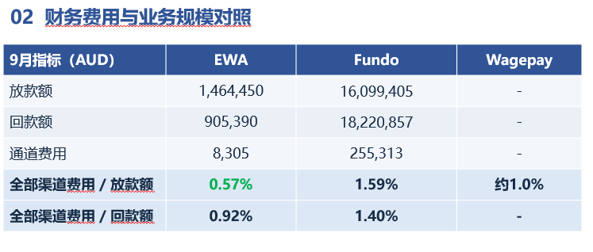

# 11月MBR · PPT 内容大纲

## 第一页 · 模型大盘情况

> 现行模型运行稳定，本月即将发布 Wagego 新客 1.0 风险主模型。

### 一、fundo

#### 1. AUC 表现（1M30）

| 月份    | 新客 AUC | 老客 AUC |
| ------- | -------- | -------- |
| 2026-01 | 0.666    | 0.733    |
| 2026-02 | 0.673    | 0.740    |
| 2026-03 | 0.629    | 0.728    |
| 2026-04 | 0.659    | 0.718    |
| 2026-05 | 0.582    | 0.719    |
| 2026-06 | 0.669    | 0.696    |
| 2026-07 | 0.649    | 0.762    |
| 2026-08 | 0.630    | 0.698    |
| 2026-09 | 0.698    | 0.778    |

> 月度口径，数据来源 fundo_model_monitor_dashboard.html；新客为 3rdmodel v1.0（`aus_new_risk_bid_3rdmodel_v1_0_20251201`），老客为 mltmodel v1.2（`old_risk_bid_mltmodel_v1_2_20260325`，现行主模型）。2026-10 仅约 1% 样本已表现（86 条），2026-11 尚无成熟样本，均暂不纳入；9 月已表现样本量：新客 3,636、老客 4,957。

#### 2. 分箱分布（申请样本 · 月度）

**新客（3rdmodel v1.0）**

| 月份    | 申请量 | 箱 1（低风险） | 箱 2  | 箱 3  | 箱 4  | 箱 5（高风险） |
| ------- | ------ | -------------- | ----- | ----- | ----- | -------------- |
| 2026-01 | 15,919 | 12.1%          | 13.4% | 15.4% | 20.3% | 38.7%          |
| 2026-02 | 16,610 | 11.5%          | 12.8% | 14.7% | 20.7% | 40.3%          |
| 2026-03 | 22,807 | 12.0%          | 13.4% | 15.0% | 20.0% | 39.6%          |
| 2026-04 | 20,012 | 11.4%          | 13.5% | 15.3% | 20.3% | 39.5%          |
| 2026-05 | 21,080 | 12.9%          | 14.3% | 15.4% | 20.8% | 36.6%          |
| 2026-06 | 21,475 | 13.2%          | 14.3% | 16.2% | 20.0% | 36.4%          |
| 2026-07 | 17,385 | 11.6%          | 12.7% | 15.1% | 20.1% | 40.5%          |
| 2026-08 | 25,484 | 9.4%           | 12.2% | 15.1% | 21.1% | 42.3%          |
| 2026-09 | 19,745 | 9.8%           | 12.8% | 15.6% | 21.3% | 40.6%          |
| 2026-10 | 22,716 | 9.0%           | 12.5% | 15.3% | 21.2% | 41.9%          |

**老客（mltmodel v1.2）**

| 月份    | 申请量 | 箱 1（低风险） | 箱 2  | 箱 3  | 箱 4  | 箱 5（高风险） |
| ------- | ------ | -------------- | ----- | ----- | ----- | -------------- |
| 2026-01 | 9,158  | 12.8%          | 15.7% | 16.8% | 20.4% | 34.3%          |
| 2026-02 | 8,780  | 12.5%          | 15.4% | 16.4% | 19.8% | 35.9%          |
| 2026-03 | 10,081 | 12.9%          | 15.1% | 16.0% | 21.3% | 34.7%          |
| 2026-04 | 7,834  | 12.7%          | 14.9% | 16.8% | 20.5% | 35.2%          |
| 2026-05 | 8,049  | 13.0%          | 14.5% | 16.4% | 21.0% | 35.1%          |
| 2026-06 | 10,060 | 12.7%          | 15.3% | 16.8% | 20.8% | 34.4%          |
| 2026-07 | 8,344  | 11.9%          | 15.0% | 17.0% | 21.4% | 34.8%          |
| 2026-08 | 12,520 | 11.7%          | 15.2% | 17.3% | 21.2% | 34.5%          |
| 2026-09 | 9,929  | 12.0%          | 15.7% | 17.7% | 22.1% | 32.4%          |
| 2026-10 | 10,811 | 11.2%          | 15.4% | 17.5% | 21.6% | 34.2%          |

> 分布口径：按申请周所属月份汇总各箱申请量占比（申请样本，未放款不剔除）；数据来源 fundo_model_monitor_dashboard.html。箱 1 为最低风险档、箱 5 为最高风险档；新客 3rdmodel v1.0（`aus_new_risk_bid_3rdmodel_v1_0_20251201`）箱 1-4 固定阈值 0.062086 / 0.091284 / 0.128392 / 0.188973，老客 mltmodel v1.2（`old_risk_bid_mltmodel_v1_2_20260325`）为 0.035078 / 0.054394 / 0.081105 / 0.132466。2026-10 为完整月，已纳入；2026-11 仅新客 806 / 老客 307 条，未完整，暂不纳入。新客箱 5 占比 36%~42%，且 8 月起箱 1 占比降至 9%~10%（年初约 12%），高风险段占比上升；老客分布相对稳定（箱 1 约 11%~13%、箱 5 约 32%~36%）。

#### 3. 老客主模型（mltmodel）1.1 vs 1.2 对比（1M30 AUC）

| 月份    | 1.1 AUC | 1.2 AUC | Δ（1.2−1.1） |
| ------- | ------- | ------- | -------------- |
| 2026-01 | 0.728   | 0.733   | +0.006         |
| 2026-02 | 0.719   | 0.740   | +0.021         |
| 2026-03 | 0.768   | 0.728   | −0.040        |
| 2026-04 | 0.704   | 0.718   | +0.014         |
| 2026-05 | 0.725   | 0.719   | −0.006        |
| 2026-06 | 0.686   | 0.696   | +0.010         |
| 2026-07 | 0.728   | 0.762   | +0.034         |
| 2026-08 | 0.687   | 0.698   | +0.011         |
| 2026-09 | 0.772   | 0.778   | +0.005         |

> 数据来源 fundo_model_monitor_dashboard.html 月度 AUC（1M30，老客）；模型：1.1 = `old_risk_bid_mltmodel_v1_1_20251021`，1.2 = `old_risk_bid_mltmodel_v1_2_20260325`；均值：1.1 为 0.724、1.2 为 0.730，Δ +0.006，9 个月中 7 个月 1.2 更优。v1.2 于 2026-09-23 上线，此前周的 v1.2 分为离线回填（回测口径）。mltmodel 1.2 多数月份小幅领先，仅 2026-03（−0.040）、2026-05（−0.006）低于 1.1。

### 二、Wagego

#### 1. AUC 表现（FPD15 · 周度）

| 放款周     | 成熟样本 | AUC    | Gini   | KS     | FPD15 坏率 | 成熟度 |
| ---------- | -------- | ------ | ------ | ------ | ---------- | ------ |
| 2026-08-31 | 694      | 0.637  | 0.273  | 0.208  | 11.10%     | 100%   |
| 2026-09-07 | 1,501    | 0.623  | 0.246  | 0.201  | 8.66%      | 100%   |
| 2026-09-14 | 2,264    | 0.627  | 0.254  | 0.203  | 8.13%      | 100%   |
| 2026-09-21 | 3,350    | 0.622  | 0.244  | 0.189  | 8.15%      | 100%   |
| 2026-09-28 | 4,684    | 0.618  | 0.237  | 0.180  | 6.81%      | 99%    |
| 2026-10-05 | 4,140    | 0.641* | 0.282* | 0.219* | 7.27%      | 74%    |
| 2026-10-12 | 670      | 0.641  | 0.282  | 0.255  | 9.40%      | 11%    |

> 模型：`aus_wagego_new_risk_bid_3rdmodel_v1_0_20260626`（Wagego 线上新客风险 1.0，发标场景）。周度口径为整体（新老客合并），按放款周统计 FPD15 成熟样本；AUC 按周内分数排名计算，周样本 <200 不纳入。* 表示 70–90% 成熟、仅参考；2026-10-12 成熟度仅 11%，为暂定值。最新确认周 2026-09-28 AUC 0.618（前 4 周均值 0.627），Gini 0.237，KS 0.180。周度维度看板不拆新老客，新老客仅月度口径提供：9 月新客 0.627 / 老客 0.622 / 整体 0.623，10 月新客 0.642 / 老客 0.630 / 整体 0.635。数据来源 vintage_监控看板.html。

#### 2. 分箱分布（申请样本 · 周度）

**新客**

| 申请周     | 申请量 | 箱 1（低风险） | 箱 2  | 箱 3  | 箱 4  | 箱 5（高风险） |
| ---------- | ------ | -------------- | ----- | ----- | ----- | -------------- |
| 2026-08-31 | 870    | 20.2%          | 29.9% | 30.7% | 10.2% | 9.0%           |
| 2026-09-07 | 1,510  | 20.9%          | 28.5% | 32.2% | 12.3% | 6.2%           |
| 2026-09-14 | 1,926  | 21.9%          | 29.4% | 31.4% | 11.2% | 6.2%           |
| 2026-09-21 | 2,607  | 23.7%          | 30.5% | 30.1% | 10.4% | 5.3%           |
| 2026-09-28 | 3,590  | 24.4%          | 29.6% | 28.7% | 11.4% | 5.9%           |
| 2026-10-05 | 3,532  | 25.1%          | 30.9% | 27.6% | 11.4% | 5.1%           |
| 2026-10-12 | 3,805  | 26.5%          | 29.5% | 27.5% | 11.1% | 5.4%           |
| 2026-10-19 | 3,969  | 25.4%          | 30.0% | 28.3% | 11.1% | 5.2%           |
| 2026-10-26 | 3,753  | 24.8%          | 31.3% | 27.7% | 10.3% | 5.9%           |

**老客**

| 申请周     | 申请量 | 箱 1（低风险） | 箱 2  | 箱 3  | 箱 4  | 箱 5（高风险） |
| ---------- | ------ | -------------- | ----- | ----- | ----- | -------------- |
| 2026-08-31 | 100    | 20.0%          | 30.0% | 32.0% | 15.0% | 3.0%           |
| 2026-09-07 | 529    | 20.8%          | 30.4% | 29.9% | 14.4% | 4.5%           |
| 2026-09-14 | 1,135  | 21.1%          | 27.7% | 30.7% | 15.9% | 4.7%           |
| 2026-09-21 | 1,767  | 22.2%          | 27.8% | 28.3% | 15.7% | 6.0%           |
| 2026-09-28 | 2,539  | 25.0%          | 27.5% | 28.4% | 13.9% | 5.3%           |
| 2026-10-05 | 3,654  | 23.9%          | 29.3% | 26.0% | 15.2% | 5.7%           |
| 2026-10-12 | 4,814  | 24.0%          | 29.2% | 26.6% | 14.0% | 6.2%           |
| 2026-10-19 | 5,648  | 25.1%          | 28.6% | 26.1% | 14.6% | 5.7%           |
| 2026-10-26 | 6,197  | 24.9%          | 29.4% | 25.2% | 14.8% | 5.6%           |

> 分布口径：按申请周（周一为周起点）统计新客/老客各箱申请量占比（申请样本，未放款不剔除）；数据来源 vintage_监控看板.html。模型 `aus_wagego_new_risk_bid_3rdmodel_v1_0_20260626`（Wagego 线上新客风险 1.0，发标时点分）；固定阈值 0.062086 / 0.091284 / 0.128392 / 0.188973，箱 1 最低风险、箱 5 最高风险。周申请量不足 100 的周（新客或老客任一侧）不展示，故从 2026-08-31 起；2026-11-02 周仅覆盖 1 天（新客 512 / 老客 583），未完整，暂不纳入。2026-08-31～10-26 合计：新客 25,562 笔，箱 1–5 占比 24.4% / 30.1% / 28.8% / 11.0% / 5.7%；老客 26,383 笔，24.2% / 28.8% / 26.6% / 14.7% / 5.7%。新客箱 1 占比由 8 月底约 20% 升至 10 月约 25%，箱 5 由约 9% 降至 5% 左右，进件质量逐周改善；老客分布相对稳定。FPD15 成熟样本共 17,434 笔，箱 1–5 坏率 4.05% / 6.80% / 9.00% / 10.44% / 20.10%，5 档/1 档 = 4.96x，整体、新客、老客均基本单调。注：此前"全量戳额样本"分布（箱 1 11.25%、箱 5 37.48%）为戳额时点 `old_score` 口径，与发标时点分口径不同，不直接可比。

#### 3. 大盘 KPI

- 最新周整体 FPD15 坏率：7.27%（n=4,140，74% 成熟）
- 新客 / 老客 FPD15 坏率（全期）：10.04% / 5.08%

---

## 第二页 · Wagego 线上模型对比

1. AUC 对比
2. 其他有价值的重要指标对比
3. 人群画像的情况（风险好的人和坏的人长什么样）

---

## 第三页 · 本月规划：以 bs cat 为基石，做两个优化

1. 代扣最优时间点预测模型优化：成本大项（数据示例）
2. Fundo当前自动代扣规则：
   定时运行（悉尼时间）当期还款：02:30、11:30、14:00、17:00、19:30、22:00逾期还款：01:00、16:00、21:30
   wage-go 扣款规则：定时运行（悉尼时间）4:00、14:00、22:00
   总体成功率（成功次数/调用次数）：fundo 12% wagego 17%
   成本情况：

## 02 财务费用与业务规模对照

| 9月指标（AUD）                  |             EWA |           Fundo |          Wagepay |
| ------------------------------- | --------------: | --------------: | ---------------: |
| 放款额                          |       1,464,450 |      16,099,405 |                - |
| 回款额                          |         905,390 |      18,220,857 |                - |
| 通道费用                        |           8,305 |         255,313 |                - |
| **全部渠道费用 / 放款额** | **0.57%** | **1.59%** | **约1.0%** |
| **全部渠道费用 / 回款额** | **0.92%** | **1.40%** |      **-** |

1. Fishkil openbanking 数据的接入，数据成本减少（数据示例）

1. 背景价值：
   1. 澳洲业务必须翻过的山：surplus
   2. 分类算法在市面上议价空间很大，算法非常地值钱、真的很贵，厂商很少
   3. 我们现在wagego的数据成本也很大，因为有贷中的查询。而且我们之后如果做
   4. illion 已经不再做 lender 的分类很多的优化了
6. 数据实战：我们用新的wagego的模型包，在bs cat自主分类 和 illion的分类同时打上了新客的风险分（这个模型是基于illion的分类训练的），但是效果非常惊喜，风险区分度是可以的。数据源如果在wagego上面做切换，是可以的位置有效的风险区分度的。。
